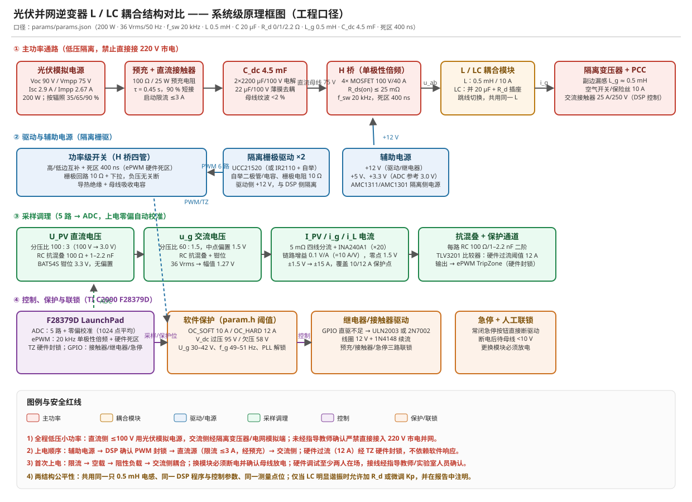

# 14 原理图与 BOM（工程口径，P2 交付物 6）

**状态（2026-11-02）**：软件阶段可完成的"原理图 + 关键参数表"部分已完成，载体为

- 系统级原理框图：[docs/schematic_system.svg](schematic_system.svg)（矢量，可直接放进报告/PPT）
- BOM（可导入 Excel）：[results/tables/BOM_canonical.csv](../results/tables/BOM_canonical.csv)（18 项）
- 本文：分模块接线、选型依据与关键参数校核

> 说明：本文件给出的是**系统级 + 模块级原理图与接线说明**，不是 EDA 工程文件（KiCad/Altium）。若结题材料需要可编辑的 EDA 原理图，作为后续一项独立任务（见 §8）。
> **渲染实测**：SVG 用 LibreOffice headless 转 PNG（2048×1486）成功，像素统计显示六个功能域色块齐备；另有独立版式校验脚本 [`tools/check_svg_layout.py`](../tools/check_svg_layout.py)：23 个色块、68 条块内文字全部放得下且不越界、色块无重叠 → **PASS**。
>
> **可重生成**：`python tools/make_schematic.py` 重新生成 `docs/schematic_system.svg` 与 `results/tables/BOM_canonical.csv`（18 项）；`python tools/check_svg_layout.py` 重跑版式验收。

---

## 1. 四个功能域（与图中颜色一致）

| 域 | 颜色 | 内容 | 关键约束 |
|---|---|---|---|
| ① 主功率通路 | 红 | 光伏模拟电源 → 预充/直流接触器 → C_dc 4.5 mF → H 桥（20 kHz 单极性倍频）→ L / LC 模块 → 隔离变压器（L_g）+ 空气开关/保险丝 → PCC | 全程低压：直流 ≤100 V；交流经隔离变压器/电网模拟端；**严禁直接接 220 V 市电**（除非指导教师确认） |
| ② 驱动与辅助电源 | 蓝 | 隔离栅驱 ×2（UCC21520 或 IR2110+自举）、栅极电阻 10 Ω、+12 V/+5 V/+3.3 V、隔离侧电源 | 死区 400 ns 由 ePWM 硬件产生；驱动侧与 DSP 侧电气隔离 |
| ③ 采样调理 | 绿 | 5 路：U_PV、u_g、I_PV、i_g、i_L；RC 抗混叠 + 3.3 V 钳位 + 上电零偏校准 | 每路比例与零点必须与 `dsp/include/param.h` 的宏一致（§3 表） |
| ④ 控制与保护 | 紫 / 橙 | F28379D：ADC/ePWM/TZ/GPIO；硬件过流 TLV3201 → TZ 封锁；继电器/接触器驱动；急停联锁 | 过流封锁走硬件 TZ，不依赖软件响应 |

## 2. 关键参数校核（工程口径，本机复算）

| 项目 | 公式 | 计算 | 结论 |
|---|---|---|---|
| 开关纹波峰峰 | `Δi_pp = Vdc/(8·L·f_sw)` | 75/(8×0.5e-3×20000) = **0.9375 A** | 为额定峰值 7.86 A 的 11.9 %，在推荐带（15–20 %）偏小侧，纹波更小 ✓ |
| 死区补偿饱和电流 | `i_sat = Δi_pp/2` | **0.469 A** | A5 的 `sat` 档补偿电流上限 |
| 最小母线电压 | `V_min = Ug_pk + ω_g(L+L_g)·Im` | 50.9 + 2π·50·1e-3×7.86 = **53.4 V** | 工程口径实算 53.38 V、基波压降 4.85 %；V_mpp 75 V 有余量 ✓ |
| LC 谐振频率 | `f0 = 1/(2π√(LC))` | 1/(2π√(0.5e-3×20e-6)) = **1591.5 Hz** | 满足 10·f_g < f0 < f_sw/10（500–2000 Hz）✓ |
| 含 L_g 的谐振 | `f_res = (1/2π)√((L+L_g)/(L·L_g·C))` | L_g=0.5 mH → **2252 Hz** | `f_res < f_s/6 = 3333 Hz` 判据成立，但 **A5 实测 R_d=0 时 LC 发散**（见 §6、docs/12），故 LC 模块必须装 R_d |
| 母线电压纹波 | `ΔU ≈ P/(2ω_g·U_dc·C_dc)` | 200/(2π·100×75×4.5e-3) = **0.94 V** | ≈1.26 % of 75 V，满足 <2 % ✓ |
| 死区误差电压 | `ΔV = 2·Td/Ts·Vdc` | 0.016×75 = **1.2 V** | 与 `DT_COMP_COEF`×Vdc 一致（1.6 % of 75 V） |
| 预充时间常数 | `τ = R·C_dc` | 10 Ω × 4.5 mF = **45 ms** | 约 5τ ≈ 0.23 s 充到 99 %；预充电阻功率校核 P=U²/R 瞬时 ≈ 562 W（仅在数十 ms 内，10 W 电阻需按脉冲校核，建议 25 W 或延长预充时间）⚠️ |

⚠️ **预充电阻是本设计里最需要复核的一项**：`U_dc=75 V` 时瞬时功率 562 W，10 W 电阻只能承受极短脉冲。建议改为 **R=100 Ω / 25 W（τ=0.45 s，5τ≈2.3 s）** 或加限流电源。此条已列入 §8 待办。

## 3. 采样链路标定表（必须与 `dsp/include/param.h` 一致）

| 通道 | 量程 | 链路比例 | 零点 | 对应宏 | 前端实现 |
|---|---|---|---|---|---|
| U_PV（直流母线） | 0–100 V | 100 : 3（33.33:1） | 0 V | `SENSE_V_DIV` = 100/3 | 精密分压 + RC 100 Ω/1–2.2 nF + BAT54S 钳位 |
| u_g（PCC 电压） | ±50.9 V 峰值 | 60 : 1.5（40:1） | 1.5 V 偏置 | `SENSE_VAC_DIV` = 60/1.5、`SENSE_VAC_OFFSET_V` = 1.5 | 隔离放大 AMC1311/AMC1301 + 分压 + 偏置网络 |
| I_PV / i_g / i_L | ±15 A | 0.1 V/A（=10 A/V） | 1.5 V 偏置 | `SENSE_I_GAIN_A_PER_V` = 10、`SENSE_I_OFFSET_V` = 1.5 | 5 mΩ 四线分流 + **INA240A1（增益 20）** + RC + 钳位 |

**选型要点**：`param.h` 要求 10 A/V（即 0.1 V/A）。`INA240A1` 增益 20 × 5 mΩ = **0.1 V/A**，正好匹配；若手头只有 `INA240A2`（增益 50，即 0.25 V/A），必须在输出串 1/2.5 分压或改 `param.h` 并重跑 `check_params.py`——**不允许两者混用**（这会导致电流环增益差 2.5 倍）。

标定方法（与 docs/02 一致）：上电先封锁 PWM，每通道采 1024 点平均做零偏自动校准；再用至少 2 点（推荐 5 点最小二乘）标比例。

## 4. 分模块接线要点

### 4.1 主功率级
- H 桥四管：高低边互补 + 400 ns 硬件死区；栅极 10 Ω + 10 kΩ 下拉；母线就近吸收电容 22 µF/100 V 薄膜。
- 直流侧上电顺序：**辅助电源 → DSP 确认 PWM 封锁 → 直流源（限流 ≤3 A，经预充电阻）→ 母线达 90 % 后接触器短接 → 交流侧**；断电后待母线 <10 V 再动手。
- 交流侧串：空气开关/保险丝 10 A → 交流接触器（DSP 控）→ 隔离变压器 → PCC；接触器动作前示波器先确认波形。

### 4.2 L / LC 耦合模块（交付物 2、3）
- 一块板 + 跳线/拨动开关的方案优先：**两结构共用同一只 0.5 mH 电感**（公平性要求），LC 只是在交流侧节点并一支路 `C 20 µF + R_d 插座`。
- 端子：4 位（a、b、PCC_L、PCC_N）；电容支路串 R_d 插座并预留电流测量环（用于测 i_C，对应 E4–E6 记录）。
- 模块上贴实测参数标签（LCR 表 10 kHz 测值），换模块前断电放电。

### 4.3 驱动与辅助电源
- 高端驱动用自举：1N4148 + 10 µF/25 V；或直接选隔离型 UCC21520（省掉自举且抗干扰更好）。
- 3.3 V 数字地与功率地在 ADC 参考点单点连接；驱动侧地与大电流回路分开走。

### 4.4 保护与联锁
- **硬件过流**：TLV3201 比较器，阈值设 12 A（对应 1.2 V），输出直接接 ePWM TripZone → 硬件封锁，不依赖软件。
- **软件保护**（`param.h`）：OC_SOFT 10 A、OC_HARD 12 A、V_dc 过压 95 V、欠压 58 V、U_g 30–42 V、f_g 49–51 Hz、PLL 解锁 1 s。
- **继电器/接触器驱动**：GPIO 直驱不足（docs/05 已知限制第 8 条），用 ULN2003 或 2N7002 + 1N4148 续流，线圈 12 V；三路联锁：预充、主接触器、故障指示。
- **急停**：常闭急停按钮直接串在驱动使能回路，按下即断驱动；任何异常先断交流侧再断直流。

## 5. BOM（18 项，完整见 [results/tables/BOM_canonical.csv](../results/tables/BOM_canonical.csv)）

| # | 类别 | 器件与规格 | 数量 | 来源 |
|---|---|---|---|---|
| 1 | 主控 | TI C2000 F28379D LaunchPad（200 MHz、12 bit ADC、ePWM+TZ） | 1 | 《实现方案》§5 |
| 2 | 功率开关 | MOSFET 100 V/40 A，R_ds(on) ≤ 25 mΩ（IRF3710 等） | 4 | 《实施方案》§4 |
| 3 | 栅极驱动 | UCC21520（隔离）或 IR2110 + 自举（1N4148+10 µF/25 V） | 2 | 《实现方案》§4/§5 |
| 4 | 辅助电源 | +12 V/1 A、+5 V/1 A、+3.3 V/0.5 A + 隔离 DCDC | 1 套 | 设计新增 |
| 5 | 母线电容 | 2200 µF/100 V 电解 ×2 + 22 µF/100 V 薄膜 | 2+1 | `params.json` C_dc 4.5 mF |
| 6 | 预充 | **100 Ω/25 W**（见 §2 复核）+ 直流接触器 | 1+1 | 《实现方案》§3 |
| 7 | 电感 L | 铁硅铝（Kool Mµ 77439 / CS468125）绕 0.5 mH/10 A | 1 | `params.json` L 0.5 mH |
| 8 | 电容 C | CBB 薄膜 10 µF/100 V ×2 | 2 | `params.json` C 20 µF |
| 9 | 阻尼电阻 R_d | 无感线绕 1.0 Ω/≥10 W、2.2 Ω/≥10 W（插座可换） | 各 1 | `params.json` R_d 0/1/2.2 Ω |
| 10 | 电流采样 | 5 mΩ/5 W 四线分流 + **INA240A1（×20）** | 3 | `param.h` SENSE_I_GAIN 10 |
| 11 | 电压采样 | 分压网络 100:3、60:1.5 + 偏置 + 隔离放大 AMC1311/AMC1301 | 2 套 | `param.h` SENSE_V_DIV / VAC_DIV |
| 12 | 硬件过流 | TLV3201 + 阈值网络（12 A ↔ 1.2 V） | 1 | `param.h` OC_HARD_A 12 |
| 13 | 继电器驱动 | ULN2003 或 2N7002 + 1N4148 续流 | 3 路 | docs/05 已知限制 8 |
| 14 | 交流侧保护 | 空气开关/保险丝 10 A + 交流接触器 25 A/250 V | 各 1 | 《实现方案》§3 |
| 15 | 隔离与并网侧 | 隔离变压器（副边漏感 = L_g）或可编程交流源 | 1 | `params.json` L_g 0.5 mH |
| 16 | 模块结构 | L/LC 同尺寸小板 + 4 位端子 + 跳线，贴实测标签 | 2 套 | 《实现方案》§4.3 |
| 17 | 测量仪器 | 示波器 ≥1 Mpts/≥5 MS/s + 差分探头 + 隔离电流探头 + LCR 表 | 1 套 | docs/02 测量配置 |
| 18 | 光伏侧电源 | 光伏模拟电源（Voc 90 V / Isc 2.9 A / Vmpp 75 V，200 W） | 1 | 《实现方案》§3 |

## 6. 与 A5 仿真的一致性

- 主电路参数（L、C、L_g、C_dc、f_sw、死区）与 `params/params.json` 逐项对齐，经 `python python/check_params.py` 机器校验（**PASS 98 / FAIL 0**）。
- A5（工程口径仿真）显示：L 结构三功率点稳态可跑通（补偿后 THD 0.43–1.83 %）；**LC 结构在 R_d=0 时三个功率点全部发散**（THD 95–380 %、HF 372–722 %）。因此 BOM 第 9 项（R_d 插座）是**必装件**而非备选，且应按《实现方案》4.2 的第二档（≥1 Ω）起步——最终取值由 E7 实验确定。

## 7. 验收对应

- 交付物 6「原理图及关键参数表」：本文 + `docs/schematic_system.svg` + `BOM_canonical.csv`（✅ 软件阶段完成）
- 交付物 2、3「L 模块 / LC 模块」：§4.2 的模块方案与端子定义已完成设计（⏳ 待制作）
- 安全条目（docs/04、docs/02）：§4.1/§4.4 的时序、联锁、放电与急停已落到接线要求

## 8. 待办与风险

1. **预充电阻复核**（§2 ⚠️）：10 Ω/10 W 在 75 V 下瞬时 562 W，需改 100 Ω/25 W 或延长预充时间后再定稿。
2. **电流链路一致性**：确认采购的是 INA240**A1**（×20）；若拿到 A2（×50）必须加分压或改 `param.h` 并重跑校验。
3. **交流侧隔离放大**：AMC1311 输入 ±2 V，需要与 60:1.5 分压匹配，采购前先用仿真定分压比。
4. **L_g 实测**：隔离变压器副边短路、LCR 表测漏感，回填 `params.json` 后重跑 A0/A5。
5. **EDA 原理图**：如需 KiCad/Altium 工程文件（可直接投板），另立任务；本文的框图和接线表可作为其输入。
6. **R_d 功率/散热**：1 Ω/10 W 无感线绕，谐振瞬态电流需按 A5 的发散波形评估（A5 已记录发散工况的峰值）。

---
*2026-11-02 建立（P2）。相关：[docs/12 参数口径](12_参数口径与单一真源.md)、[docs/02 实验规程](02_experiment_protocol.md)、[docs/04 风险与安全](04_risk_and_safety.md)*